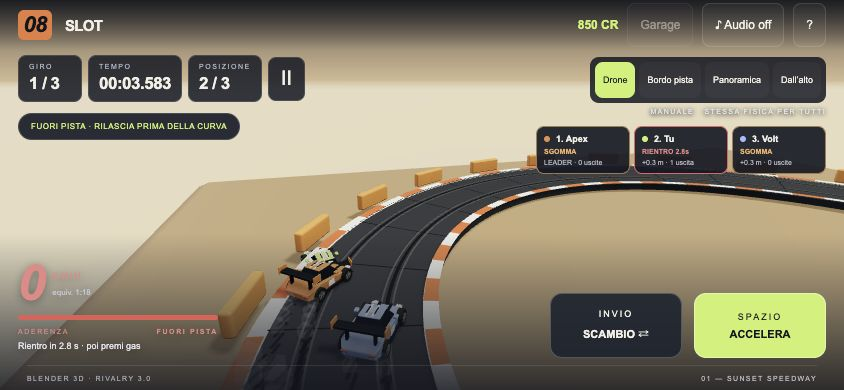

# Verifica SLOT 08 — Rivalry 3.0

18 novembre 2026. Questa verifica sostituisce quella della versione Ignition 2.0.

## Regressione riprodotta

Prima dell'aggiornamento, sull'ovale in Rookie manuale, tenere il gas fisso concludeva la gara in circa 30,2 s: primo posto, zero uscite. I rivali erano regolatori ideali senza tempo di reazione e senza errori di stima.

## Test automatici

**52 test Node superati** (`npm test`). I controlli comprendono:

- Nove combinazioni pista/difficoltà: gas costante provoca un'uscita già nel primo giro, anche con magneti potenziati al massimo.
- Sbandata recuperabile al rilascio; nello stesso scenario, continuare ad accelerare causa l'uscita.
- Giocatore e bot con gli stessi input: identici avanzamento, velocità, angolo di sbandata, instabilità, uscite e tre secondi di recupero.
- Componenti e potenziamenti uguali per tutta la griglia.
- Rivali con semi deterministici: sbandate e uscite prodotte dalla fisica, senza eventi di deragliamento imposti dall'IA.
- Assistenza completa le tre piste alle tre difficoltà, con scambio di corsia e senza uscite del giocatore.
- Guide pin fermo sullo slot durante la rotazione del corpo macchina; segno corretto nelle due direzioni.
- Giri, scambi, recupero, tutorial, progressione e protezione dai premi duplicati.
- Classifica calcolata dopo aver aggiornato tutti gli attraversamenti del traguardo nello stesso passo di simulazione.
- Risultati indipendenti dal frame rate e nuovi record separati dalla fisica precedente.

### Confronto deterministico

Sunset, Club, auto base, seme 808, passo 1/120 s. È un benchmark software, non una prova di abilità umana.

| Comandi del giocatore | Tempo | Uscite | Posizione |
| --- | ---: | ---: | ---: |
| Gas sempre premuto | 93,967 s | 18 | 3° |
| Regolatore manuale vicino al limite (pace 0,98) | 36,633 s | 0 | 2° |
| Guida assistita prudente | 40,975 s | 0 | 3° |

Nel secondo scenario Apex chiude in 36,613 s: il distacco è di circa 20 ms. Gli errori dei rivali variano fra gare e traiettorie; non ogni bot deve uscire in ogni gara. Nessuna correzione di velocità, forza magnetica o progresso in base al piazzamento.

## Browser e comandi

Prova reale nel browser integrato, con viewport desktop, 390×844 e 844×390 (non dispositivi mobili fisici):

- Club/manuale e assistenza disattivata presenti come predefiniti.
- Gas continuo: visualizzati SGOMMA, ALZA IL GAS e successivamente FUORI PISTA con conto alla rovescia.
- Sbandata recuperata premendo nuovamente il gas a interruttore per rilasciarlo: nessuna nuova uscita.
- Nella gara manuale osservate due uscite di Apex nella classifica; Volt ha concluso senza uscite.
- Gara assistita con scambio completata in 39,199 s: terzo posto, zero uscite, 130 CR (profilo locale con motore livello 1).
- Gomme segnate sull'asfalto, rotazione del retrotreno e fumo; modelli Blender caricati.
- Audio attivato e disattivato senza errori di console. La qualità sonora non è stata misurata.
- Comandi e classifica visibili in verticale e orizzontale. Il traverso della partenza viene nascosto vicino all'auto nelle visuali drone/bordo pista per non coprire la guida.
- Fallback Canvas2D: gara e uscita di pista funzionanti, nessun errore di console.
- Grafo JavaScript e CSS versionati per impedire il riuso dei moduli 2.0 dopo l'aggiornamento.

## Prestazioni e limiti

Segni delle gomme e fumo usano due pool a dimensione fissa (320 segni, 96 particelle), due draw call, senza geometrie create per frame. Nessun effetto modifica la simulazione.

Le auto non collidono fra loro in questa versione. La pendenza dei ponti è visiva; la dinamica laterale usa la proiezione orizzontale. Progressi locali, nessun multiplayer o salvataggio condiviso fra dispositivi. Nessuna garanzia di frame rate su hardware non provato.

## Verifica della pubblicazione

Distribuzione GitHub Pages completata con successo sulla revisione `ddbbf86`.
URL verificato: https://gabrielecapponi-ux.github.io/slot08-ignition/

Ricaricando la scheda che aveva già aperto Ignition 2.0 sono stati caricati titolo Rivalry Update, footer RIVALRY 3.0, Club/manuale e la nuova classifica. Prova pubblica con gas continuo: uscita del giocatore alla prima curva (circa 3,5 s), entrambi i rivali indicati in sbandata, gas disattivato al deragliamento e rientro di tre secondi. Nessun errore/warning di console. La pagina è stata lasciata al menu, senza eliminare progressi.

