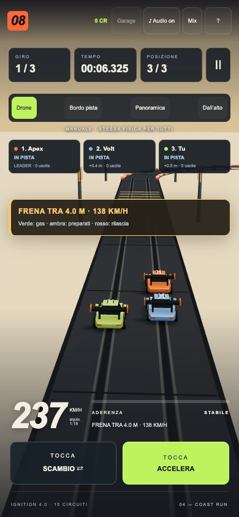

# SLOT 08 — IGNITION / OVERDRIVE 4.0

Gioco slot-car 3D originale per browser, senza account, dipendenze CDN o servizi a pagamento. Three.js 0.180.0 è incluso. GT e tre diorami originali sono modellati in Blender; i dodici nuovi circuiti modulari sono costruiti dal percorso fisico condiviso; progetto Higgsfield 3D Jutsu incluso nei riferimenti.

## Aggiornamento Overdrive 4.0

- **15 circuiti subito selezionabili**, da 32 a 196 metri: 12 nuovi tracciati con rettilinei fino a 62,4 metri, curve opposte, chicane, moduli rialzati, scambi e cordoli. Il tempo di gara cresce con il circuito, sempre tre giri.
- **Colonna sonora originale a 136 BPM**, sintetizzata localmente: cassa, basso sincopato, hi-hat, clap e frase melodica variabile. Il filtro segue il ritmo della guida e la musica si abbassa durante le sgommate. Non è una generazione Suno: il modello non era disponibile nel collegamento.
- **Motore, freno motore, gomme, impatti, scambi e traguardo** hanno suoni distinti, ricavati dallo stato reale delle auto. Attiva l’audio con il pulsante in alto. Mixer con volumi separati e memorizzati; nessun autoplay. Mettere la musica a zero lascia gli effetti attivi.
- **Coach di frenata**: attivo automaticamente nei primi quattro circuiti, opzionale ovunque. Ambra indica fra quanti metri rilasciare; rosso indica di farlo ora. Strisce sulla pista, velocità consigliata e tono discendente aiutano a leggere la curva. Il coach informa soltanto; la guida assistita è un’opzione separata.
- **Due o tre persone sullo stesso dispositivo**, con comandi indipendenti e camera condivisa che inquadra il gruppo. Il primo arrivo apre una finestra di 30 secondi per gli altri; vince il tempo reale al traguardo. Nessun multiplayer online. Le gare locali non attribuiscono crediti al profilo.
- Progressi, potenziamenti e record di Rivalry conservati. Le piste sono accessibili senza dover completare prima le precedenti; le gare contro i bot continuano a premiare le prestazioni.

## Fisica competitiva

La gara parte in **Club / manuale**. Tenere il gas premuto non basta: il retrotreno sgomma in curva, il pattino accumula instabilità e si stacca se non alleggerisci. Alzare il gas in tempo permette di salvare la sbandata. Segni delle gomme, fumo e stridio (con audio attivo) rendono leggibile il limite.

**Stesse condizioni per tutta la griglia:** giocatore e bot hanno identico motore, magneti, freno, potenziamenti, modello di sbandata e recupero di tre secondi. I rivali hanno tempi di reazione, valutazioni imperfette delle curve e scambi di corsia; non ricevono velocità extra in base alla tua posizione. La classifica mostra chi sta sgommando, le uscite e i rientri.

La guida assistita resta un'opzione di allenamento: frena con più margine e tende a essere più lenta. Il tutorial usa questa protezione. Rookie offre più tenuta a tutti, Pro riduce il margine per tutta la griglia e avvicina i bot al limite. Crediti e potenziamenti esistenti restano disponibili. La fisica è quella di Rivalry 3.0 e i suoi record rimangono validi.

## Gioca online

**[Apri SLOT 08 Ignition](https://gabrielecapponi-ux.github.io/slot08-ignition/)** — funziona dal telefono e dal computer; il Mac non deve rimanere acceso.

Sul telefono, tieni premuto **ACCELERA** per dare gas e tocca **SCAMBIO** per prenotare il cambio corsia. Puoi anche attivare **Gas a interruttore** nel menu: un tocco accende il gas, il successivo lo spegne. Il gioco si adatta a schermo verticale e orizzontale. La prima partenza include un tutorial pratico.

Progressi e crediti si salvano nel browser del dispositivo: non sono sincronizzati fra telefono e Mac. Non serve un account GitHub per giocare.



## Avvio e sviluppo locali

```sh
npm start
```
Apri http://127.0.0.1:4173. Non occorre `npm install`; serve Node 20 o superiore. `npm run build` crea `dist/`, pronto per un qualsiasi hosting statico.

`npm run standalone` genera `SLOT08.html`, un singolo file con codice, motore grafico e modelli incorporati. Il link online è il modo consigliato per giocare dal telefono; le anteprime dei file scaricati possono limitare JavaScript.

## Pubblicazione GitHub Pages

Il sito usa il ramo **main**, cartella **/(root)**. Tutti i percorsi sono relativi, incluso l'import map di Three.js, quindi funziona anche sotto `/slot08-ignition/`. Il file `.nojekyll` disabilita l'elaborazione Jekyll. Non servono chiavi API, CDN o un server applicativo.

Per aggiornare il sito: incrementa la versione in `package.json`, esegui `npm test` e `npm run build`, verifica il gioco con `npm start`, poi pubblica le modifiche su `main`. Il build aggiorna in `index.html` gli URL di CSS, ingresso JavaScript e ogni modulo applicativo, evitando che il browser conservi parti della vecchia fisica. GitHub Pages distribuisce automaticamente l'ultima revisione. Il sorgente, il GLB e la scena Blender sono inclusi nel repository; i pacchetti generati sono esclusi dal versionamento.

## Comandi

| Comando | Azione |
| --- | --- |
| Spazio / ACCELERA / pressione sulla pista | Gas; rilasciare rallenta |
| Invio / SCAMBIO | Prenota lo scambio alla prossima X; seconda pressione annulla |
| Shift / freccia destra o sinistra | Alternative a Invio |
| C | Drone → bordo pista → panoramica → dall'alto |
| P / Esc | Pausa / riprendi |
| Gas a interruttore | Un clic/tasto avvia il gas, un altro lo spegne |

In modalità locale:

| Pilota | Gas | Scambio |
| --- | --- | --- |
| P1 verde | Spazio | Invio |
| P2 arancione | W | E |
| P3 azzurro | I | O |

Su touch ogni pilota usa il proprio pannello colorato. Il gas a interruttore funziona per tutti. Alcune tastiere possono limitare il numero di tasti simultanei: la modalità a interruttore evita di doverli tenere premuti insieme. Nelle gare locali, toccare la pista non accelera nessuno.

La prima partenza sulla pista 1 apre una scuola guida con tre prove reali. Puoi saltarla o ripeterla. Due pulsanti grandi funzionano anche con mouse e puntatori assistivi. Il gas si disattiva quando la finestra perde il focus; la gara va in pausa.

## Gare e progressione
Tre diorami originali e dodici piste endurance. Gara da tre giri contro due IA, gara locale in due/tre oppure Time Attack libero. Nelle gare contro i bot guadagni 105–180 crediti secondo posizione e uscite; compra tre livelli di motore, magneti o freno (100 / 180 / 280 CR). Le stelle premiano posizione e guida pulita. Tutte le auto usano gli stessi potenziamenti. Progressi e record restano nel browser tramite localStorage; senza storage il gioco funziona ma non conserva i progressi dopo la chiusura.

| # | Circuito | Lunghezza |
| --- | --- | ---: |
| 1 | Sunset Speedway | 32,1 m |
| 2 | Skyline Eight | 33,0 m |
| 3 | Neon Harbor | 43,4 m |
| 4 | Coast Run | 75,5 m |
| 5 | Canyon Switch | 77,8 m |
| 6 | Airstrip XL | 94,3 m |
| 7 | Serpent Valley | 102,4 m |
| 8 | Salt Flats | 106,8 m |
| 9 | Viaduct Rush | 109,6 m |
| 10 | Switchback GP | 147,1 m |
| 11 | Night Express | 127,9 m |
| 12 | Alpine Marathon | 157,7 m |
| 13 | Docklands GP | 140,9 m |
| 14 | Grand Tour | 179,0 m |
| 15 | Endless Summit | 196,0 m |

Rookie aumenta il margine di tenuta; Club usa la taratura base; Pro riduce il margine e rende più rapidi gli avversari. La guida assistita è indipendente e dosa il gas prima delle curve. Nessuna sterzata manuale. Il tachimetro mostra km/h equivalenti in scala 1:18: `velocità modello × 3,6 × 18`. Non è una misura della velocità reale del giocattolo.

## Motore e scelte tecniche
- Passo fisso 120 Hz; rendering indipendente con interpolazione. Recupero frame limitato per evitare grandi salti dopo una sospensione.
- Domanda laterale `F = m v² |κ|`; il gas riduce del 16% la tenuta disponibile a piena apertura. Sbandata progressiva attorno al pattino anteriore e instabilità che cresce durante il sovraccarico. Il rilascio ripristina tenuta e stabilità; sovraccarico prolungato o estremo provoca il deragliamento. Frenata al rilascio, resistenza aerodinamica e attrito durante la sbandata. È un modello arcade, non una simulazione certificata di un prodotto reale.
- Velocità misurata lungo la corsia effettiva: la metrica corregge corsie interne/esterne e scambi quintici. L'ovale e l'otto sono analitici; il porto usa Catmull-Rom con tabella di lunghezza precalcolata e derivate analitiche. I nuovi circuiti usano poligoni raccordati con rette e archi analitici, con tangenti continue e scambi limitati ai rettilinei.
- L'auto deragliata scivola lungo la tangente con attrito e gravità, mentre il progresso sul giro resta fermo. Ritorna nello stesso punto dopo tre secondi. Il timer continua: nessuna seconda penalità duplicata.
- Enter prenota un cambio persistente; l'esecuzione avviene esclusivamente nella sezione X. Le IA e l'assistenza percorrono la stessa fisica, compresa la curva dello scambio.
- I record sono distinti per versione della fisica, pista, modalità, difficoltà, assistenza e potenziamenti.
- Una sola camera e un solo renderer; Canvas2D è il fallback per dispositivi senza WebGL. Audio sintetico opt-in. Asset statici raggruppati per materiale; pixel ratio limitato.

## Struttura
```
src/core/       configurazione, matematica, ciclo a passo fisso
src/track/      geometria e catalogo circuiti
src/physics/    stato auto, accelerazione, sbandata, tenuta, deragliamento
src/ai/         previsione curve, reazioni, errori e controllo del gas
src/game/       gare, tutorial, coach di frenata, progressione e tarature
src/input/      tastiera, mouse, pulsanti e gas a interruttore
src/camera/     regia, inseguimento e accessibilità del movimento
src/render/     Three.js e alternativa Canvas2D
src/ui/         telemetria e minimappa
src/audio/      motori multivoce, effetti, mixer e sequencer musicale
blender/        scena editabile e generatori delle geometrie
assets/         modello GLB e render
vendor/         Three.js e licenza MIT
scripts/        server locale e packaging
tests/         test di fisica, progressione e assistenza
```

## Modificare le scene
Apri `blender/slot08.blend`. `CAR_GT` è la radice del modellino; `LEVEL_0`, `LEVEL_1`, `LEVEL_2` sono i tre diorami. Le tre radici sono separate nello spazio in Blender; il gioco centra solo quella attiva. Il file GLB include tutte le geometrie senza texture esterne.

`node scripts/export-track-data.mjs` genera i campioni condivisi. `blender/upgrade_ignition.py` documenta la costruzione della versione Ignition sulla scena v1; non eseguirlo ripetutamente sulla v2 perché aggiunge dettagli alla GT. Per rigenerare da zero, usa `blender --background --python blender/rebuild.py` dopo aver esportato i dati del tracciato. Lo script ricostruisce una scena nuova; non lanciarlo su lavoro non salvato. L'esportazione finale usa trasformazioni/modificatori applicati. La camera di gioco è controllata da `src/camera/rig.js`, non dalla camera Blender.

Progetto 3D Jutsu: https://higgsfield.ai/3d-jutsu/8c2e8aed-d52f-4ac8-89af-cdbda6850d8c — scena Ignition revisione 3. Il modello locale è stato rigenerato con gli stessi script in Blender 5.2.1 dopo l'interruzione del trasferimento.

## Verifica
```sh
npm test
```
Vedi `QA.md` per prove e limiti. È un prototipo giocabile: niente multiplayer online, collisioni fra auto, editor piste, loop verticali o salti balistici vincolati alla pista. La fisica laterale usa la proiezione orizzontale del tracciato; la pendenza del ponte è visiva, senza variazione del carico magnetico. Non è un prodotto affiliato a Hot Wheels o Carrera.
