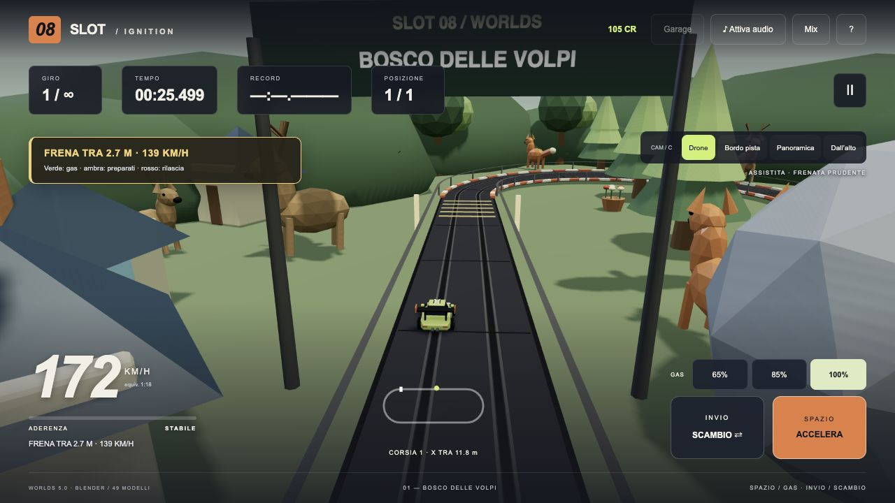
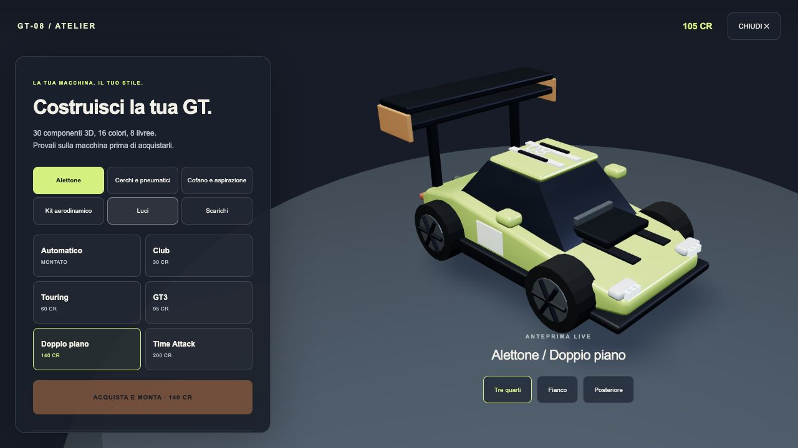

# SLOT 08 — IGNITION / WORLDS 6.0

**[Gioca dal telefono o dal computer](https://gabrielecapponi-ux.github.io/slot08-ignition/)** — il Mac non deve restare acceso. Browser 3D, senza account o servizi a pagamento. Three.js 0.180.0 è incluso nel repository.

## Novità 6.0 — 20 novembre 2026

- Gas al 65% all’avvio, cursore 20–100% e pulsanti +/− del 5% per ciascun pilota. Freccia su/giù per P1, oltre alle tre preselezioni. La risposta al gas sale più gradualmente; il rilascio resta rapido.
- Più tempo per recuperare una sbandata moderata. Le prove di riferimento mantengono il pattino agganciato per 800 ms al 145% della tenuta disponibile; questo non garantisce lo stesso margine a ogni velocità. Un eccesso grave può ancora causare un’uscita rapida. Stessa fisica per bot e persone.
- Nuovi cieli panoramici per tutti i circuiti, terreno con rilievi, mare costiero, vegetazione, dettagli stradali e gallerie con guscio esterno. Il terreno resta piano lungo l’intera sede della pista.
- Le tre spirali ora escono verso una sequenza di curve opposte, con ponti più leggibili e guardrail verticali. Gallerie, incroci su due quote e paraboliche restano percorribili.
- **60 componenti 3D**, dieci per categoria; **20 livelli meccanici** per sistema. Ducktail, swan neck, ali a delta, cerchi turbofan, dischi aero, V8 esposto, tromboncini, scarichi laterali e molte altre forme. Ogni scelta mostra una descrizione e l’anteprima sulla GT.
- Nuovi modelli Blender di coniglio, gufo, stambecco, tartaruga, felci, funghi, panchina, lampione, arco di roccia e barca. Gli stambecchi sostituiscono i pinguini negli scenari alpini; il vecchio modello resta nel catalogo.

I crediti, gli acquisti e i potenziamenti precedenti rimangono. I record 6.0 hanno una chiave nuova perché fisica e alcune piste sono cambiate. Le immagini di gioco più sotto documentano la versione 5.0: la nuova versione non è stata verificata nel browser in questa sessione. Vedi QA.md.

## Caratteristiche

- **Tutti i 15 circuiti rinnovati**, in sette ambientazioni: bosco, Alpi, porto, costa, canyon, deserto, notte. Modelli originali di alberi, animali, edifici e portali creati realmente in Blender. Uccelli, piccoli movimenti degli animali e pale dei mulini animati; animazioni ambientali ferme con movimento ridotto.
- **Gallerie percorribili**, incroci su cavalcavia e paraboliche che inclinano la pista e la GT. Tre piste contengono una vera spirale; Double Helix sale di 5,2 metri con due giri aggiuntivi. Le corsie sovrapposte hanno almeno 1,8 metri di separazione verticale. In panoramica, i tetti diventano trasparenti per seguire le auto.
- **Gas più leggibile:** cursore e pulsanti 65%, 85%, 100% indipendenti per ciascun pilota; P1 usa anche 1, 2, 3. Il gas sale in modo progressivo, il rilascio resta rapido. La sbandata avvisa prima del deragliamento e può essere recuperata. Nei test di riferimento, mezzo secondo di sbandata moderata lascia ancora tempo per salvarsi; non è una garanzia a qualsiasi velocità.
- **Garage con anteprima 3D reale:** 60 componenti in sei categorie (ali, cerchi, cofani, kit aerodinamici, luci, scarichi), 16 vernici e 8 livree. Tre inquadrature e anteprima gratuita prima dell'acquisto. Le parti acquistate si rimontano senza pagarle di nuovo. Colori e livree sono gratuiti.
- **20 livelli ciascuno** per motore, magneti/pneumatici e freno motore. In modalità Automatico, gruppi di livelli cambiano anche cofano, scarichi, cerchi o kit aerodinamico. Un componente manuale prevale sull'aspetto automatico. I componenti estetici non aggiungono bonus fisici nascosti.
- **Stesse regole per giocatore e bot:** stessi potenziamenti, tenuta, sbandata e tre secondi di recupero. I bot stimano male alcune curve e possono uscire. Niente accelerazioni in base alla classifica o teletrasporti.

Restano il tutorial pratico, il coach di frenata, quattro telecamere, gare contro due bot, Time Attack e gare locali per due/tre persone sullo stesso dispositivo. La musica originale a 136 BPM e i suoni di motore, rilascio, gomme e impatto sono sintetizzati dal gioco. Premi Attiva audio; il mixer separa musica ed effetti. Nessun autoplay.





## Comandi

| Comando | Azione |
| --- | --- |
| Spazio / ACCELERA / pressione sulla pista | Gas; il rilascio frena |
| 1 / 2 / 3, oppure pulsanti 65% / 85% / 100% | Potenza del gas di P1 |
| Freccia su / giù; cursore e pulsanti +/− | Regola il gas a passi del 5% |
| Invio / SCAMBIO | Prenota la prossima X; seconda pressione annulla |
| Shift / frecce laterali | Alternative a Invio |
| C | Drone, bordo pista, panoramica, dall'alto |
| P / Esc | Pausa / riprendi |
| Gas a interruttore nel menu | Un tocco accende, un altro spegne |

In locale: P1 Spazio/Invio, P2 W/E, P3 I/O. Ogni pilota ha pulsanti touch e potenza indipendenti. Dopo il primo arrivo, gli altri hanno 30 secondi. Non è multiplayer tra telefoni. Le auto non si urtano.

Per iniziare: scegli Rookie, gas 65% e coach acceso. Passa all'85% quando riconosci le curve e al 100% sui rettilinei. Il gas ridotto non garantisce di superare ogni curva. La guida assistita frena al posto tuo ed è una scelta separata, più prudente. Perdere il focus mette in pausa e spegne il gas.

## Circuiti

Le lunghezze sono riferite al percorso centrale in pianta: l'effettiva distanza percorsa dipende da corsia, pendenza e scambi.

| # | Circuito | Lunghezza | Carattere |
| --- | --- | ---: | --- |
| 1 | Bosco delle Volpi | 32.1 m | Tra pini, animali e una galleria di pietra. |
| 2 | Passo dei Cervi | 44.3 m | Due rami incrociati, ponte alto e galleria. |
| 3 | Porto delle Lanterne | 58.3 m | Banchine, fari e curve sul lungomare. |
| 4 | Palm Coast | 75.5 m | Un lungo allungo tra palme e case sul mare. |
| 5 | Red Rock Canyon | 77.8 m | Mesas, galleria nel canyon e curve opposte. |
| 6 | Spirale del Bosco | 82.4 m | Una vera spirale sopraelevata tra gli alberi. |
| 7 | Alpine Crossing | 60.7 m | Doppio senso di curva, incrocio a due quote. |
| 8 | Dune Paraboliche | 106.8 m | Curve inclinate e un rettilineo nel deserto. |
| 9 | Harbor Flyover | 72.2 m | Un cavalcavia attraversa il porto illuminato. |
| 10 | Copper Spiral | 116.5 m | Un giro elicoidale fra pareti di roccia. |
| 11 | Neon Junction | 80.1 m | Ponte incrociato, gallerie e insegne notturne. |
| 12 | Glacier Summit | 157.7 m | Rampe, tunnel e rifugi nel paesaggio alpino. |
| 13 | Coastal Switchback | 87.9 m | Doppio tracciato incrociato lungo la costa. |
| 14 | Grand Forest Tour | 179.0 m | Il grande circuito tra mulini e villaggi. |
| 15 | Double Helix | 167.9 m | Due giri di spirale, 5,2 metri di dislivello. |

## Progressione e salvataggi

Tutte le piste sono aperte. Le gare contro i bot assegnano stelle e crediti: 105–180 CR di base, moltiplicati fino a due sulle piste lunghe. Gare locali e Time Attack non attribuiscono crediti. I prezzi dei 20 livelli sono 100, 180, 280, 350, 430, 520, 620, 730, 850, 980, 1120, 1270, 1430, 1600, 1780, 1970, 2170, 2380, 2600, 2830 CR. I componenti estetici costano 30, 60, 95, 140, 200, 260, 330, 410, 500 o 600 CR.

Il vecchio profilo viene conservato, inclusi crediti, medaglie e potenziamenti. I record della nuova fisica usano la chiave worlds-6: quelli precedenti restano salvati ma non sono confrontati con i nuovi circuiti. Il salvataggio è locale al browser, senza sincronizzazione tra Mac e telefono. Se lo storage non è disponibile si può comunque giocare.

## Architettura e fisica

- src/track: geometria analitica, catalogo, spirali, sopraelevazione e tunnel. ScenicTrack decora il percorso base. Rendering, auto, coach e IA leggono la stessa superficie.
- src/physics: motore puro senza DOM, passo fisso a 120 Hz. Accelerazione, inerzia, frenata, aderenza e recupero. La velocità segue la distanza tridimensionale della corsia, incluse pendenze e scambi quintici.
- La domanda laterale è m·v²·|κ|. La sopraelevazione riduce la forza da sostenere con magneti e gomme: max(0, m·v²·|κ|·cos(φ) − m·g·sin(|φ|)). La piena apertura riduce del 7% la tenuta disponibile. L'instabilità cresce nel tempo e si riduce con il rilascio; la scocca ruota intorno al pattino anteriore prima di staccarsi.
- È fisica arcade: non simula il carico verticale dinamico o l'effetto della gravità sulla velocità lungo una salita. Deragliamento con scivolamento e gravità, progresso sul giro congelato e rientro nello stesso punto dopo tre secondi, senza doppia penalità.
- src/ai: solo input di gas e scambio, previsione di frenata, reazioni e errori riproducibili. src/game: gare, profilo, coach e catalogo officina. src/input: comandi e potenza. src/audio: motori, effetti e sequencer.
- src/render: geometrie modulari, props Blender istanziati, pool limitati di fumo e segni, gestione delle risorse condivise. Un solo renderer WebGL, riutilizzato dal garage. src/camera/rig.js possiede la regia. Il garage statico viene ridisegnato solo quando cambia.
- Pixel ratio massimo 1,5; niente postprocessing pesante o download durante la gara. Il kit nuovo pesa circa 651 KB compressi (4,85 MB decodificati). Canvas2D è il fallback senza WebGL: consente di giocare, ma non mostra componenti o scenari 3D.

## Avvio, test e build

Node 20 o successivo. Non serve npm install.

```sh
npm start
npm test
npm run build
npm run standalone
```

Anteprima su http://127.0.0.1:4173. Build statico in dist/. SLOT08.html incorpora anche entrambi i GLB ed è escluso dal versionamento. Per i telefoni è consigliato il link online, perché alcune anteprime dei file scaricati limitano JavaScript.

Pages pubblica main, cartella root. Incrementare package.json, eseguire test e build, verificare e pubblicare. Il build aggiorna gli URL di tutti i moduli applicativi e del CSS per evitare cache miste. Nessuna chiave API o dipendenza CDN.

## Asset Blender modificabili

Le copie portabili versionate sono `assets/worldkit.glb.gz` e `blender/worldkit.blend.xz`. Il gioco decomprime il GLB all’avvio usando DecompressionStream; serve un browser moderno con questa API. Se l’API manca, la modalità 3D essenziale continua senza il kit decorativo, con avviso. Il file standalone incorpora il kit compresso.

Per ricreare i file modificabili dopo un clone, eseguire `python3 scripts/unpack-assets.py` (Python 3, nessuna dipendenza). Sul computer di sviluppo esistono già sia il GLB sia il BLEND non compressi. La compressione è senza perdita: geometrie e materiali rimangono identici.


- blender/worldkit.blend: catalogo completo dei 89 elementi nuovi, disposto su un tavolo per ispezionarlo. I componenti della GT sono ingranditi 6× nel catalogo; il GLB è esportato prima di questo allestimento, nella scala corretta.
- blender/build_worldkit.py: generatore originale riproducibile; usa una scena pulita. Eseguire in un processo Blender separato: blender --background --python blender/build_worldkit.py. Produce assets/worldkit.glb, scena editabile e contact sheet assets/worldkit-preview.png.
- blender/slot08.blend e assets/slot08.glb: modello GT originale. I vecchi diorami restano nel sorgente per riferimento; Worlds costruisce tutte le piste dalla geometria corrente e non li visualizza.
- Il riferimento Higgsfield del precedente progetto Ignition rimane https://higgsfield.ai/3d-jutsu/8c2e8aed-d52f-4ac8-89af-cdbda6850d8c . Il catalogo 6.0 è stato generato ed esportato con Blender 5.2 nel progetto gratuito https://higgsfield.ai/3d-jutsu/f751b35d-ea52-4fc7-b8e6-a8f802bd90f1 perché Blender locale si arrestava durante l’inizializzazione Metal. Nessuna generazione a pagamento. Il file scaricato conserva il catalogo allestito: il loader normalizza posizione e scala dei singoli modelli.

Vedi QA.md per le verifiche. Prototipo originale, non affiliato a Hot Wheels o Carrera. Nessun multiplayer online, editor delle piste, urti tra auto, loop verticali o salti guidati.
